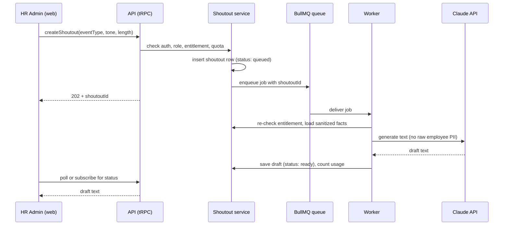

# Novelty EMS — AI Feature Proposal: AI Shoutout Studio

## 1. Summary

This document proposes the first AI-powered feature for the Novelty EMS multi-tenant SaaS application. It is a **paid-tier feature**: only tenants with an active paid subscription can use it. Its main output is branded, shareable content that **shouts out Novelty EMS** each time a tenant uses it.

**Feature name:** AI Shoutout Studio
**Target tier:** Paid plans only (Free and trial-expired tenants see an upgrade prompt, never the generated output)
**Primary users:** HR Admins (generate and publish). Managers may request a shoutout for their team, subject to HR approval (see open questions).
**Status:** Proposal. Needs Product sign-off on the open questions in section 12 before build.

## 2. Problem

- HR teams spend time writing recognition posts, new-hire welcome messages, work anniversary notes, and milestone announcements.
- Those posts are often generic, late, or skipped.
- Novelty EMS has no outward-facing presence inside the product. Tenants who like the product have no easy way to talk about it.

AI Shoutout Studio solves the first problem for the tenant and the second problem for Novelty.

## 3. Goals and non-goals

### 3.1 Goals

1. Let a paying tenant generate high-quality recognition and announcement content from approved HR events in seconds.
2. Include a consistent, tasteful "Powered by Novelty EMS" attribution on every generated post for paid tenants.
3. Make the feature a clear reason to subscribe, and make the upgrade path visible on every locked state.
4. Keep employee-sensitive data out of AI prompts and out of the provider's logs.
5. Enforce tenant isolation, role scope, and subscription status on the server for every call.

### 3.2 Non-goals (Phase 1 of this feature)

- Automatic posting to external social networks. Tenants copy or share the output themselves.
- Free-form chat over HR data. (Possible later as a separate "AI Assistant" feature.)
- Generating content about individual employees' health, compensation, disciplinary, or performance-rating data. These are blocked by policy (section 7.3).
- Training or fine-tuning any model on tenant data.

## 4. User stories

| ID    | As a...         | I want to...                                                                 | So that...                                                       |
| ----- | --------------- | ---------------------------------------------------------------------------- | ---------------------------------------------------------------- |
| AS-01 | HR Admin (paid) | pick an event (new hire, anniversary, milestone, team win) and get a draft  | I can announce it quickly.                                       |
| AS-02 | HR Admin (paid) | choose tone (formal, warm, playful) and length (short, standard)             | the post fits our company voice.                                 |
| AS-03 | HR Admin (paid) | edit the draft before I copy or share it                                     | I stay in control of what goes out.                              |
| AS-04 | HR Admin (paid) | copy the final text or download it as an image card                          | I can post it in Slack, Teams, email, or LinkedIn.               |
| AS-05 | HR Admin (Free) | see what the feature does and an upgrade button, but not generated output    | I understand the value before I pay.                             |
| AS-06 | Manager         | request a shoutout for a direct report                                       | recognition happens without waiting for HR to notice.           |
| AS-07 | HR Admin        | review usage and see how many shoutouts were generated this billing period  | I can track value and plan usage.                                |
| AS-08 | Platform admin  | see generation volume and cost per tenant                                    | I can manage margin and abuse.                                   |

## 5. Subscription gating

### 5.1 Entitlement model

Access is decided by an **entitlement check**, not by the UI. The UI only hides or shows controls.

| Concept         | Source                                          | Notes                                                                 |
| --------------- | ----------------------------------------------- | --------------------------------------------------------------------- |
| Plan            | Tenant subscription record                      | `free`, `paid` (Pro), `enterprise`. Names are placeholders.           |
| Status          | Tenant subscription record                      | `trialing`, `active`, `past_due`, `canceled`, `expired`.              |
| Feature flag    | Plan-to-feature mapping in code or config       | Key: `ai.shoutout_studio`. Enabled for `paid` and `enterprise`.       |
| Usage quota     | Plan-to-quota mapping                           | Example: monthly generation cap per tenant. Exact numbers are open.   |

### 5.2 Rules

1. A generation request is allowed only when **all** of these are true:
   - The tenant's status is `active` or `trialing`.
   - The plan includes `ai.shoutout_studio`.
   - The tenant is under its monthly quota.
   - The requester has a permitted role for the action (section 6).
2. `past_due` tenants keep read access to shoutouts they already generated, but cannot create new ones. This gives a grace period without losing data.
3. `canceled` and `expired` tenants keep their history. New generation is blocked. Exports of existing content remain allowed for HR Admins.
4. Every blocked request returns a typed error (for example `FEATURE_NOT_IN_PLAN` or `SUBSCRIPTION_INACTIVE`) so the UI can show the right upgrade or billing message.
5. Entitlement is checked in the **service layer**, not only in the tRPC procedure or the web app. Background jobs also check it at run time, because a subscription can lapse between enqueue and execution.
6. Plan changes take effect immediately for new requests. Already-running jobs finish, but their output is only shown if the tenant is still entitled when the result is saved.

### 5.3 Billing dependency

No billing or subscription module exists in the repository yet (checked against `docs/`). This feature depends on one. Recommended first step: a billing provider (for example Stripe Billing) that sends webhooks, with a local `tenant_subscriptions` table as the source of truth for entitlement checks. The application must never call the billing provider synchronously on each generation request.

## 6. Roles and access

| Action                                | HR Admin | Manager          | Employee | Notes                                                  |
| ------------------------------------- | -------- | ---------------- | -------- | ------------------------------------------------------ |
| Generate a shoutout (any event type)  | Yes      | No               | No       | Team-wide events and company-wide announcements.       |
| Request a shoutout for a direct report | No       | Yes              | No       | Creates a `requested` item; HR Admin approves.         |
| Approve or reject a request           | Yes      | No               | No       |                                                        |
| Edit and publish (copy or download)   | Yes      | Own requests only | No       |                                                        |
| View usage and quota                  | Yes      | No               | No       | Tenant-level counters only.                            |

Rules that apply to every row:

- Every shoutout belongs to exactly one tenant (`tenant_id` is required and always filtered on).
- Managers see only their own requests and only the direct reports they are allowed to see.
- Employee records are referenced by internal ID inside the app. Names appear in the final text only when the HR Admin includes them.

## 7. AI behavior and data handling

### 7.1 Model and provider

- Provider: Anthropic Claude API, called from the **worker** (BullMQ job), not from the browser.
- Default model for generation: `claude-sonnet-5-5` for quality.
- Cheaper option for short, simple posts: `claude-haiku-5-5`. The routing rule is an open decision.
- Model IDs are configuration, not hard-coded, so they can change without a code release.
- Use a system prompt that fixes the output format, tone rules, and the Novelty EMS attribution line.

### 7.2 Request flow

This follows the existing queue pattern in `docs/queue-setup.md`. The HTTP request returns as soon as the job is queued. Report-style generation (`docs/report-generation.md`) is the reference for status tracking and retries.

### 7.3 Data minimization (required)

- Send only the **facts needed** for the post. Example: `{ "event": "work_anniversary", "years": 3, "team": "Engineering", "firstNameAllowed": true, "firstName": "..." }`.
- **Never send** compensation, bank details, national IDs, health or medical data, leave reasons, disciplinary records, performance ratings, or document contents.
- The first name is sent only when the HR Admin ticks "include name". Default is off.
- Prompts and outputs must not be written to application logs. Log the shoutout ID, tenant ID, token counts, latency, and status only.
- Confirm the provider's data retention and training terms, and sign the required data processing agreement, before launch.

### 7.4 Output safety

- Output is a **draft**. Nothing is shared until the HR Admin copies or downloads it.
- Reject outputs that contain other employees' names, phone numbers, emails, or IDs that were not in the input facts.
- Run a basic content check for profanity and for claims that look like commitments (for example "guaranteed bonus"). Flagged drafts are shown with a warning, not silently dropped.
- Attribution rule: the line "Powered by Novelty EMS" (with the product link) is appended by the **server**, not by the model, so it cannot be removed by prompt manipulation.

## 8. The shoutout: how Novelty EMS is promoted

This is the part that makes the feature work for the business as well as for the tenant.

1. **Attribution footer.** Every generated text and image card includes "Powered by Novelty EMS" and a short link to the product landing page. The link carries a campaign tag (for example `?utm_source=shoutout`) so marketing can measure it.
2. **Shareable image card.** A one-click export creates a branded card with the tenant's post text and the Novelty EMS footer. It is sized for LinkedIn, Slack, and Teams. The card is generated server-side so the layout stays consistent.
3. **Opt-out is not offered on paid plans.** The footer is the price of the lower-cost plan. Enterprise white-label is an open question (section 12).
4. **Public showcase (optional, later).** With tenant permission, a shoutout can be featured on a public Novelty EMS "customer wins" page. This requires explicit consent per post and is out of scope for the first release.

Any text that names a real person or company must follow the tenant's own consent rules. The product must never publish content on a tenant's behalf.

## 9. Data model (proposed)

Names are proposals. Final names follow the existing Drizzle schema conventions in `packages/database`.

| Table                  | Key fields                                                                                                     | Notes                                                        |
| ---------------------- | -------------------------------------------------------------------------------------------------------------- | ------------------------------------------------------------ |
| `tenant_subscriptions` | `id`, `tenant_id`, `plan`, `status`, `current_period_start`, `current_period_end`, `provider_customer_id`, `updated_at` | Updated by billing webhooks. Source of truth for entitlement. |
| `ai_shoutouts`         | `id`, `tenant_id`, `requested_by_user_id`, `event_type`, `tone`, `length`, `status`, `input_facts` (sanitized), `draft_text`, `final_text`, `model`, `input_tokens`, `output_tokens`, `error_code`, `created_at`, `updated_at` | `status`: `queued`, `generating`, `ready`, `failed`, `shared`, `blocked`. |
| `ai_shoutout_requests` | `id`, `tenant_id`, `manager_user_id`, `employee_id`, `event_type`, `status`, `decided_by_user_id`, `decided_at`    | Manager requests awaiting HR approval. Optional in first release. |
| `ai_usage_monthly`     | `tenant_id`, `period_start`, `generated_count`, `token_total`                                                  | Quota counter. Updated in the same transaction as the draft save. |
| `audit_events`         | existing table                                                                                                 | Write an event for create, approve, reject, copy/download, and blocked attempts. |

Indexes to plan: `(tenant_id, created_at)` on `ai_shoutouts`, `(tenant_id, period_start)` on `ai_usage_monthly`, and `(tenant_id, status)` on `ai_shoutout_requests`.

## 10. API surface (proposed tRPC procedures)

| Procedure                         | Access     | Purpose                                              |
| --------------------------------- | ---------- | ---------------------------------------------------- |
| `shoutouts.getEntitlement`        | Any user   | Returns `{ enabled, reason, quotaRemaining }` for the UI. |
| `shoutouts.create`                | HR Admin   | Validates input, checks entitlement, queues the job. |
| `shoutouts.get`                   | HR Admin   | Returns status and draft for polling.                |
| `shoutouts.update`                | HR Admin   | Saves the edited `final_text`.                       |
| `shoutouts.exportCard`            | HR Admin   | Returns a branded image or a signed URL.             |
| `shoutouts.list`                  | HR Admin   | Paginated history, tenant-scoped.                    |
| `shoutoutRequests.create`         | Manager    | Creates a request for a direct report.               |
| `shoutoutRequests.decide`         | HR Admin   | Approves or rejects a request.                       |

Every procedure follows the four-step pattern in `docs/notes.md`: database model, service, tRPC procedure, web call.

## 11. Delivery plan

| Phase | Scope                                                                                           | Exit criteria                                                                 |
| ----- | ----------------------------------------------------------------------------------------------- | ----------------------------------------------------------------------------- |
| 0     | Billing foundation: `tenant_subscriptions`, webhook handler, entitlement service, locked-state UI | A test tenant can move between `free` and `paid` and the gate changes correctly. |
| 1     | Core generation: `ai_shoutouts`, queue job, Claude call, draft review screen, footer, quota     | HR Admin generates, edits, and copies a shoutout. Blocked for `free`. Tests pass. |
| 2     | Image card export and usage dashboard                                                           | Card renders in both light and dark UI. Usage counts match DB rows.           |
| 3     | Manager requests and HR approval                                                                | Manager cannot see or request for employees outside their scope (test proves it). |
| 4     | Hardening: content checks, cost alerts, retry and failure UX, load test                         | Failed jobs show a retry option. Cost per shoutout is within the agreed budget. |

Phase 0 must ship before any AI work. Without it there is no enforceable paid gate.

## 12. Open questions

1. **Plans and pricing:** What are the plan names, prices, and which features sit in each? Is the shoutout feature in every paid plan or only in the top plan?
2. **Quota:** How many shoutouts per month per plan? What happens at the limit: block, or sell extra packs?
3. **Attribution:** Is the "Powered by Novelty EMS" footer mandatory for all paid plans, or may Enterprise remove it (white-label)?
4. **Manager requests:** Do managers need the request flow in the first release, or only HR Admins?
5. **Billing provider:** Stripe or another provider? Who owns the webhook endpoint and retry handling?
6. **Model routing:** Use one model for all shoutouts, or route short posts to the cheaper model?
7. **Data processing:** Which provider region and data processing agreement apply to tenant data? Does any tenant contract forbid sending employee names to third-party AI?
8. **Public showcase:** Is a public "customer wins" page in scope for this year, and what consent flow does it need?
9. **Localization:** Which languages must the first release support?

## 13. Risks

| Risk                                                    | Impact                                   | Mitigation                                                                                  |
| ------------------------------------------------------- | ---------------------------------------- | ------------------------------------------------------------------------------------------- |
| Paid gate bypassed through a direct API call            | Revenue loss                             | Entitlement check in the service layer and in the worker. Tests for each blocked state.    |
| Employee PII sent to the AI provider                    | Privacy breach, contract breach          | Data minimization (7.3), allowlisted input fields, no raw-record prompts, DPA before launch. |
| AI output names the wrong person or invents facts       | Embarrassment for the tenant             | Draft-only flow, human review before copy, output check for unknown names.                  |
| Cost overrun from heavy use                             | Negative margin                          | Per-tenant monthly quota, cost alerts, cheaper model routing for short posts.               |
| Footer seen as spam or unwanted by tenants              | Churn                                    | Tasteful design, clear value (free-to-read output quality), Enterprise white-label option.  |
| Subscription lapses during a running job                | Unpaid output shown                      | Re-check entitlement before saving the result (5.2, rule 6).                                |
| Provider outage                                         | Failed generation                        | BullMQ retries with backoff; `failed` status with a retry button; no charge against quota.  |

## 14. Success metrics

- **Conversion:** Share of tenants that start a paid plan after viewing the locked state.
- **Activation:** Share of paid tenants that generate at least one shoutout in their first 14 days.
- **Retention:** Monthly shoutout generation per active paid tenant.
- **Reach:** Clicks on the "Powered by Novelty EMS" link, tracked by campaign tag.
- **Quality:** Share of drafts copied without major edits (proxy for quality).
- **Cost:** Average model cost per shoutout, tracked per tenant.

## 15. Testing requirements

- **Entitlement tests:** each combination of plan and status returns the right result, from the service and from the procedure.
- **Tenant isolation tests:** a shoutout from tenant A cannot be read, updated, or exported by tenant B.
- **Role tests:** Employee and Manager cannot call HR-only procedures. Manager requests are limited to direct reports.
- **Data minimization tests:** the prompt builder rejects forbidden fields, and the logger never receives prompt or output text.
- **Attribution test:** every exported text and card contains the footer, even when the model output omits it.
- **Quota tests:** the counter increments once per successful draft, not per retry.
- **Downgrade test:** a tenant that drops to `free` mid-job does not see the output.

## 16. Related documents

- `docs/functional-requirements.md`: tenant model, roles, and access scope.
- `docs/phase-1-technology-architecture.md`: stack, queue, and authorization layer.
- `docs/queue-setup.md`: Redis and BullMQ pattern for the generation job.
- `docs/report-generation.md`: status tracking and retry pattern for async output.
- `docs/novelty-ems-phase1-feature-roadmap.md`: where this feature fits in the delivery plan.

---

## 17. Additional AI feature suggestions

This section proposes further AI features derived from `docs/functional-requirements.md`. Each one names the FR area it serves, so the suggestion can be traced to an agreed requirement. None of these is approved yet. They follow the same rules as AI Shoutout Studio: paid-tier gating (section 5), server-side tenant and role checks, data minimization (section 7.3), and human review before anything takes effect.

### 17.1 Summary and priority

| ID    | Feature                                      | Primary FR area     | Main users           | Value    | Effort | Suggested order |
| ----- | -------------------------------------------- | ------------------- | -------------------- | -------- | ------ | --------------- |
| AI-02 | Policy and HR Document Assistant (RAG)       | FR-08, FR-13        | Employee, HR Admin   | High     | Medium | 1               |
| AI-01 | New-Hire Onboarding Assistant                | FR-07               | New hire, HR Admin   | High     | Medium | 2               |
| AI-03 | Natural-Language Directory Search            | FR-06               | HR Admin, Manager    | High     | Low    | 2               |
| AI-04 | Leave Request Assistant                      | FR-09               | Employee, Manager    | Medium   | Low    | 3               |
| AI-05 | Manager Approval Briefing                    | FR-09, FR-12        | Manager              | Medium   | Low    | 3               |
| AI-06 | Attendance Anomaly Explainer                 | FR-10               | HR Admin, Manager    | High     | Medium | 4               |
| AI-07 | Biometric Reconciliation Suggestions         | FR-10               | HR Admin             | Medium   | Medium | 5               |
| AI-08 | Compliance Exam Question Generator           | FR-07               | HR Admin             | Medium   | Low    | 3               |
| AI-09 | Personal Productivity Coach (employee only)  | FR-11, FR-12        | Employee             | Medium   | Medium | 6               |
| AI-10 | Team Workload Insights (manager)             | FR-11, FR-12        | Manager, HR Admin    | Medium   | Medium | 6               |
| AI-11 | Data Quality and Import Assistant            | FR-01, FR-04, FR-06 | HR Admin             | High     | Medium | 4               |
| AI-12 | Announcement Drafting and Translation        | FR-12               | HR Admin             | Medium   | Low    | 5               |
| AI-13 | Audit Log Investigator                       | FR-14               | HR Admin, Platform   | Medium   | Medium | 7               |
| AI-14 | Holiday and Policy Notice Extraction         | FR-10, FR-12        | HR Admin             | Low      | Low    | 8               |

Suggested order is a starting point. Priority 1 and 2 should be checked against the Phase 1 scope in section 2.3 of the functional requirements before work starts.

### 17.2 AI-01: New-Hire Onboarding Assistant

- **Problem:** New hires have many questions in their first week (where to find forms, who to ask, what the onboarding steps are). HR answers the same questions repeatedly.
- **What it does:** A chat panel inside onboarding (FR-07). It answers questions about the three onboarding steps, the welcome documents, and tenant policies, and it shows the current status of the employee's own onboarding tasks.
- **Sources:** Only HR-published welcome documents (FR-07 item 8), the tenant's policy documents, and the employee's own onboarding progress. It never reads other employees' records.
- **Behavior:** Every answer cites its source document and version. When the assistant has no source, it says so and offers to create an HR ticket instead of guessing.
- **Guardrails:** Retrieval is filtered by `tenant_id` and by document status (published only). Conversation history is stored for the tenant and visible only to HR Admins for audit, not used for training.
- **Done when:** A new hire can finish all three steps with no HR contact in a pilot tenant, and no answer lacks a citation.

### 17.3 AI-02: Policy and HR Document Assistant (RAG)

- **Problem:** Leave, WFH, and attendance rules are spread across documents. Employees ask managers or HR to explain them.
- **What it does:** A search-and-answer tool over published policy documents (FR-08 leave policies, FR-13 documents). It answers questions such as "How many carry-forward days do I have?" only where the policy text supports an answer.
- **Data:** Documents are chunked and embedded per tenant. Each chunk stores `tenant_id`, document ID, version, and effective date, so a search always returns the policy version that applied on the date asked.
- **Balance questions:** Personal balance answers come from the leave balance records (FR-08) by a deterministic lookup, not from the model. The model only explains the rule.
- **Guardrails:** Document access rules from FR-13 apply to retrieval. A restricted document is never returned to a user who cannot open it. Financial and restricted documents are excluded from the index by default.
- **Done when:** Retrieval tests prove tenant isolation and that restricted documents never appear in another user's results.

### 17.4 AI-03: Natural-Language Directory Search

- **Problem:** The directory (FR-06) has filters for department, location, status, and dates. Users must know which filter to use.
- **What it does:** The user types "active engineers in Pune who joined this year". The model converts the text into a structured filter object, which the user reviews before the search runs.
- **Safety design:** The model outputs only an allowlisted filter schema. It never writes SQL. The server applies the viewer's role and scope after the filter is built, so the result is the same as the standard search with those filters.
- **Guardrails:** Names and fields not permitted to the viewer cannot be used as filters. The generated filter is shown as chips so the user can see and edit it.
- **Done when:** The filter schema is covered by tests, and a Manager's natural-language query never returns someone outside their scope.

### 17.5 AI-04: Leave Request Assistant

- **Problem:** Employees forget holidays, overlap with teammates, or write unclear reasons when they request leave.
- **What it does:** Before submit, it checks the requested dates against tenant holidays (FR-10), team overlap, and remaining balance (FR-08). It also offers to rewrite a short, professional reason, and it suggests a message to the manager.
- **Safety design:** The conflict and balance checks are rules, not AI. The model is used only for wording.
- **Data minimization:** The leave reason is sent to the model only when the employee presses "help me write". It is not sent for the automatic checks. This follows section 7.3, where leave reasons are on the never-send list.
- **Done when:** Overlap and holiday warnings appear without any AI call, and rewrite requests are logged with IDs and token counts only.

### 17.6 AI-05: Manager Approval Briefing

- **Problem:** Managers approve requests one by one with little context on team coverage (FR-09).
- **What it does:** A short daily summary for each manager. It lists pending requests, coverage gaps on the same dates, and conflicts with approved leave. It may suggest a decision, but the manager always decides.
- **Scope:** Only the manager's direct reports and assigned approval work (FR-03).
- **Guardrails:** The briefing does not include leave reasons. It never uses the word "approve" as an automatic action. Each suggestion shows the facts it is based on.
- **Done when:** A manager sees only their own team's data, and every suggestion links back to the request.

### 17.7 AI-06: Attendance Anomaly Explainer

- **Problem:** Missing check-outs, repeated late arrivals, and biometric gaps are found late and explained poorly (FR-10).
- **What it does:** Rules and statistics find the anomalies first, such as a missing check-out or a check-in far from the employee's usual pattern. The model then writes a plain explanation and a suggested next step for HR or the manager.
- **Safety design:** Detection is deterministic and documented, so the FR-10 average check-in and check-out calculation stays the single source of truth. The model does not decide whether an anomaly is a violation.
- **Guardrails:** Anomalies follow the attendance visibility rules in FR-10. Unmatched biometric records are visible only to authorized reconciliation users.
- **Done when:** Each flagged anomaly can be traced to a rule, and the explanation does not change the stored attendance data.

### 17.8 AI-07: Biometric Reconciliation Suggestions

- **Problem:** Unmatched biometric records need manual matching to employees (FR-10, rule 9), which is slow.
- **What it does:** For each unmatched device ID, it suggests likely employee matches from the device label, department, shift, and past matched records. HR confirms or rejects each suggestion.
- **Guardrails:** Suggestions are never auto-applied. Each decision is audited (FR-14). Biometric data itself is never sent to the model. Only the minimal match features are used.
- **Done when:** Confirmed matches are idempotent with the source IDs, and the acceptance rate is tracked as a quality metric.

### 17.9 AI-08: Compliance Exam Question Generator

- **Problem:** Writing security and compliance exam questions takes HR and security time (FR-07, item 9).
- **What it does:** From the approved training material, it drafts questions in the allowed types, with correct answers and explanations. HR edits and approves each question before it enters the question bank.
- **Guardrails:** Generated questions are drafts until approved. Learners never see the model in the exam flow. The passing threshold, retry limit, and scoring stay fixed rules, not AI decisions.
- **Done when:** No unapproved question can appear in an exam, and each approved question keeps its source reference.

### 17.10 AI-09: Personal Productivity Coach

- **Problem:** Employees see logged hours and expected hours (FR-11) but rarely understand what the numbers mean.
- **What it does:** A private weekly summary for the employee. It explains the trend, notes gaps in Jira worklog sync, and suggests how to log time more consistently.
- **Scope:** Visible to the employee only by default. Managers and HR see aggregated team figures only, under AI-10.
- **Guardrails:** The summary must not be used as a performance rating. It never compares the employee with peers. Only the employee's own numbers are sent to the model, with no task titles unless the employee opts in, because Jira ticket text can contain sensitive detail.
- **Done when:** The productivity formula is the approved one from FR-11, and the summary matches the dashboard numbers.

### 17.11 AI-10: Team Workload Insights

- **Problem:** Managers see headcount and productivity separately, and they miss workload imbalance or sync gaps (FR-12).
- **What it does:** A weekly view for managers that highlights team members with unusually high or low logged time, uneven leave load, and missing worklog syncs.
- **Guardrails:** The feature shows patterns for planning, not a ranking of people. Individual names appear only where the manager already has access. It is not offered for any decision on compensation or discipline.
- **Done when:** A manager cannot see figures for anyone outside their scope, and each insight links to the source numbers.

### 17.12 AI-11: Data Quality and Import Assistant

- **Problem:** Bulk employee imports and existing spreadsheets often have missing fields, inconsistent designation names, and duplicate employees (FR-01, FR-04, FR-06).
- **What it does:** During import, it maps spreadsheet columns to employee fields, suggests fixes for inconsistent reference values (for example "Sr. Engineer" to "Senior Engineer" in the active list), and flags likely duplicates by email and name. It also scans existing profiles for missing required fields (FR-05).
- **Guardrails:** The model proposes mappings and fixes. The HR Admin confirms every change. Reference values are matched only against tenant-configured lists (FR-01), so the model cannot create new departments or designations.
- **Done when:** An import of a sample file reaches a confirmed, duplicate-free result, and every applied change appears in the audit log.

### 17.13 AI-12: Announcement Drafting and Translation

- **Problem:** Multi-location tenants publish announcements in several languages, and HR writes them from scratch (FR-12).
- **What it does:** Drafts a tenant announcement from a short brief, then translates the approved version into the languages used by the tenant's locations.
- **Relation to AI Shoutout Studio:** This reuses the generation pipeline, quota, and attribution rules from sections 7 and 9. It must not be a second copy of that pipeline.
- **Guardrails:** Translations are labeled as machine-generated. The HR Admin reviews each language before publishing. Announcements go to the tenant only and never to external channels.
- **Done when:** A translated announcement is published only after a reviewer has approved each language version.

### 17.14 AI-13: Audit Log Investigator

- **Problem:** Compliance reviews need to answer questions such as "who changed this salary field last quarter" and "were there any bulk exports this month" (FR-14).
- **What it does:** A natural-language search over audit events that returns a timeline and a short summary, with links to each event.
- **Safety design:** The model builds a filter over audit events, and the query runs under the requester's permissions. Audit events are already masked (FR-14 item 3), so the model reads masked values only.
- **Guardrails:** Access to this feature is limited to HR Admins with audit permission, and each query is itself audited.
- **Done when:** Every answer links to the events it used, and the feature cannot return events from another tenant.

### 17.15 AI-14: Holiday and Policy Notice Extraction

- **Problem:** Holiday lists and policy changes arrive as PDFs or emails, and HR enters them by hand (FR-10 item 7, FR-12).
- **What it does:** Extracts holiday dates and policy effective dates from an uploaded notice into draft records. HR reviews and saves them.
- **Guardrails:** Extracted values are drafts. Dates are stored as date-only values in the tenant timezone (section 4, rule 10 of the functional requirements).
- **Done when:** Extracted holidays match a reviewed sample set above the agreed accuracy target.

### 17.16 Cross-cutting rules for all AI features

1. **Entitlement:** Every AI feature uses the entitlement check in section 5 and gets its own feature key, for example `ai.onboarding_assistant`.
2. **Tenant and role scope:** Retrieval, filters, and generated output apply the same scope as the standard views (FR-03, FR-06, FR-12). Scope is enforced in the service layer, not in the prompt.
3. **Data minimization:** Each feature has an allowlist of input fields. Forbidden categories from section 7.3 apply everywhere. Prompts and outputs are not written to logs.
4. **Human decision:** No AI output changes employee, attendance, leave, or onboarding records on its own. The user confirms every change.
5. **Explainability:** Each output shows its sources, or the facts it was based on.
6. **Quotas and cost:** Each feature counts against a monthly quota with the same counter pattern as `ai_usage_monthly`.
7. **Evaluation:** Each feature has a test set and a quality metric before release, following section 15 of this document.
8. **Provider terms:** The DPA and data-retention checks in section 7.3 and section 12 apply to every feature, not only AI Shoutout Studio.

### 17.17 Open questions for these features

1. Which features belong in the first paid plan, and which should be free to drive adoption?
2. Is a vector store acceptable in the current stack, or should retrieval start with keyword search over published documents?
3. Do employees accept AI-generated productivity summaries (AI-09), or should this stay HR-only?
4. Who approves the use of Jira ticket text in any prompt?
5. Should conversation history for AI-01 be kept, and for how long, under the retention rules in FR-14?
