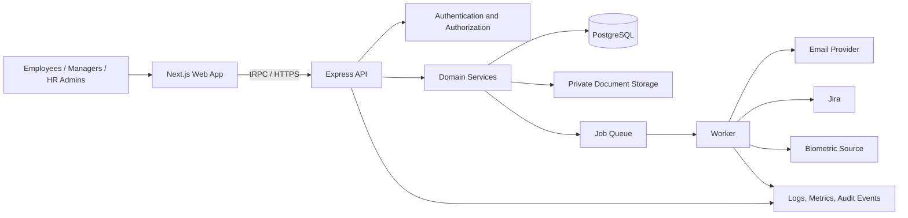

# Novelty EMS Phase 1 — Technology Stack & Architecture

## 1. Executive summary

Novelty EMS Phase 1 should use a **modular monolith**: one web application, one API service, one PostgreSQL database, and background workers for scheduled or integration work.

This is the right architecture for Phase 1 because the system has many connected HR workflows—employee identity, role-based access, onboarding, leave approvals, attendance, and dashboards—but does not yet need the operational cost and distributed-data risks of microservices. The modules are separated in code and can be extracted later only if scale or team ownership makes that necessary.

## 2. Proposed technology stack

| Area            | Technology                                                                  | Why it fits Phase 1                                                                                                                                      |
| --------------- | --------------------------------------------------------------------------- | -------------------------------------------------------------------------------------------------------------------------------------------------------- |
| Monorepo        | pnpm + Turborepo                                                            | Already in use. Shares types, tooling, and business packages across web and API applications.                                                            |
| Web application | Next.js 16, React 19, TypeScript                                            | Already in use. Good for a responsive role-based internal web application.                                                                               |
| UI and forms    | Tailwind CSS, Radix UI, React Hook Form, Zod                                | Already available. Provides accessible UI primitives and consistent client-side validation.                                                              |
| API             | Express 5 + tRPC 11 + OpenAPI generation                                    | Already in use. Gives type-safe internal API calls while preserving documented REST/OpenAPI endpoints for approved integrations.                         |
| Business logic  | TypeScript service layer in `packages/services`                             | Keeps business rules independent from routes and UI; easier to test and evolve by module.                                                                |
| Database        | PostgreSQL + Drizzle ORM + versioned migrations                             | Already in use. PostgreSQL is reliable for transactional workflows such as leave balances and approvals.                                                 |
| Authentication  | Google OpenID Connect plus email/password; secure HTTP-only cookie sessions | Meets the Google SSO and credential-login requirements. Passwords must use Argon2id or bcrypt—not a fast hash/HMAC.                                      |
| Authorization   | Fixed-role and record-scope policy layer                                    | Enforces Employee, Manager, and HR Admin access on the server, including direct-report boundaries and sensitive-data rules.                              |
| Async work      | Queue worker with Redis-backed jobs (for example BullMQ)                    | Reliably handles scheduled invites, email retries, notification batches, Jira syncs, biometric imports, and migration jobs outside the request path.     |
| File storage    | Private object storage with encryption (for example Amazon S3)              | Supports onboarding and employee documents without storing files in the database. Access is granted through short-lived signed URLs after authorization. |
| Observability   | Structured application logs, error monitoring, metrics, audit-event table   | Supports launch readiness, integration diagnostics, and traceability of HR actions. Do not log employee-sensitive values.                                |
| Testing         | Vitest, API/integration tests, Playwright end-to-end tests                  | Covers business rules, API/authorization boundaries, and role-specific user journeys.                                                                    |
| CI/CD           | GitHub Actions or equivalent, containerized API/worker deployment           | Runs lint, type checks, tests, migrations, and controlled environment deployments.                                                                       |

## 3. High-level architecture



### Request flow

1. The browser authenticates with Google SSO or email/password.
2. The API resolves the user to one employee identity and establishes a secure session.
3. Each API request passes through authentication, fixed-role authorization, and record-level scope checks.
4. A domain service validates the request, applies business rules, and performs database work in a transaction when required.
5. Long-running or scheduled work is submitted to the queue instead of delaying the user request.
6. Audit events record important administrative actions without putting sensitive field values into logs.

## 4. Application structure

```text
apps/
  web/                 Next.js role-based web interface
  api/                 Express host for tRPC and OpenAPI endpoints

packages/
  database/            Drizzle schema, migrations, database client
  trpc/                API contracts, routers, request context
  services/            Domain services and use cases
  auth/                Session, SSO, password, and authorization policies
  jobs/                Queue definitions and worker handlers
  notifications/       Email and in-app notification delivery
  integrations/        Jira and biometric adapters
  logger/              Safe structured logging
```

Each functional module should own its API routes, service logic, data model, validation schemas, tests, and authorization rules. Initial modules are:

- Identity and access
- Employees, profile, and employment history
- Onboarding and invitations
- Organization settings and reference data
- Leave, WFH, and approvals
- Attendance and calendar
- Timesheets and Jira integration
- Notifications and announcements

## 5. Why a modular monolith fits the requirements

| Requirement                                     | Architectural response                                                                                                                                                  |
| ----------------------------------------------- | ----------------------------------------------------------------------------------------------------------------------------------------------------------------------- |
| Three fixed roles with strict data boundaries   | A central policy layer applies role and record-level checks to every API and export. UI hiding is only a convenience; it is not security.                               |
| Leave balances and approvals must stay accurate | PostgreSQL transactions keep balance updates, approval decisions, and workflow status changes atomic.                                                                   |
| Dashboards combine many sources                 | A single transactional database makes Phase 1 dashboards simpler and more consistent. Build dashboard queries from validated module data, not duplicate data pipelines. |
| Scheduled invites and integration syncs         | Queue workers make work retryable, observable, and independent of browser/API request timeouts.                                                                         |
| Jira and biometric integrations may change      | Adapter interfaces isolate each external provider from core employee, attendance, and timesheet models. Imports must be idempotent.                                     |
| Auditability and HR data sensitivity            | Central audit events, secure storage, least-privilege access, and redacted logs protect sensitive workforce data.                                                       |
| Delivery speed for Phase 1                      | One deployable backend and shared TypeScript contracts reduce coordination and integration overhead for a small-to-medium engineering team.                             |

## 6. Data and security principles

1. **PostgreSQL is the system of record.** Drizzle migrations are version-controlled; schema changes are reviewed and deployed in order.
2. **The server enforces access.** Employees access their own records, Managers access only approved direct-report workflows, and HR Admins receive organization-wide access where required.
3. **Financials and Documents are sensitive.** Managers must be denied through UI, API, exports, and signed-file access.
4. **Use secure authentication.** Passwords require Argon2id/bcrypt with unique salts; sessions use secure, HTTP-only, same-site cookies with rotation and expiry. Tokens must not be exposed to browser JavaScript.
5. **Do not log sensitive employee data.** Logs and error reports use IDs, event types, and redacted metadata. Secrets stay in environment variables or a managed secrets service—never in source control.
6. **Encrypt sensitive data.** Use encryption at rest for databases and object storage; assess field-level encryption for financial, identity, or document metadata.
7. **Make integrations safe to retry.** Jira and biometric records need source identifiers, deduplication constraints, sync timestamps, and reconciliation reporting.
8. **Keep an audit trail.** Record actor, action, entity, timestamp, and safe before/after metadata for HR administration, policy changes, overrides, and workflow decisions.

## 7. Deployment recommendation

Use separate development, staging, and production environments:

- **Web:** Next.js deployment behind HTTPS/CDN.
- **API and worker:** containerized services with independent scaling.
- **Database:** managed PostgreSQL with automated backups, point-in-time recovery, and encrypted connections.
- **Redis:** managed Redis only for queues/cache; it is not the source of truth.
- **Object storage:** private encrypted bucket for documents; public buckets are not appropriate.
- **Secrets:** managed secret store or environment-injection mechanism; never commit credentials, API keys, or certificates.

Production infrastructure, backups, access policies, monitoring alerts, and recovery procedures require review before launch. Any CloudFront/S3 CORS or certificate automation change also requires production review.

## 8. Delivery architecture sequence

1. Establish database migrations, API conventions, session/authentication, authorization policies, audit events, and test tooling.
2. Build organization reference data, employee creation, invitation scheduling, and onboarding.
3. Build employee profile, employment history, and directory with role-scoped access.
4. Build leave/WFH policies, requests, balances, and approval workflows using transactions.
5. Add attendance, calendar, Jira worklog sync, and dashboards from verified source data.
6. Add notifications, biometric integration, migration/reconciliation, end-to-end tests, and operational readiness.

## 9. Explicit Phase 1 boundaries

- Do not start with microservices, event sourcing, a data warehouse, custom roles, payroll, or a performance-management engine.
- Keep integrations behind adapters and enable them only after their provider contract, identity mapping, failure handling, and reconciliation rules are agreed.
- Dashboards are read models over established workflows; they should follow—not define—business rules.
- Reassess service extraction only when a module has independent scaling, availability, data-ownership, or team-ownership needs.

## 10. Decisions needed before implementation

The architecture supports the roadmap, but these decisions must be confirmed before the corresponding work is finalized:

- Employee lifecycle transitions and onboarding completion conditions
- Leave entitlement, accrual, carry-forward, and approval rules
- Attendance rules and timezone policy
- Expected-hours source and productivity formula
- MFA provider, recovery process, and acknowledgement evidence requirements
- Email provider and invitation expiry rules
- Jira and biometric provider contracts, identity mapping, and sync behavior
- Data migration sources, field mapping, reconciliation criteria, and cutover plan

## Recommendation

Adopt the existing TypeScript/Turborepo stack and build it as a secure modular monolith with PostgreSQL as the source of truth, queue workers for asynchronous processes, and integration adapters for Jira and biometric systems. This delivers Phase 1 quickly while preserving clear module boundaries and a safe path to scale later.
